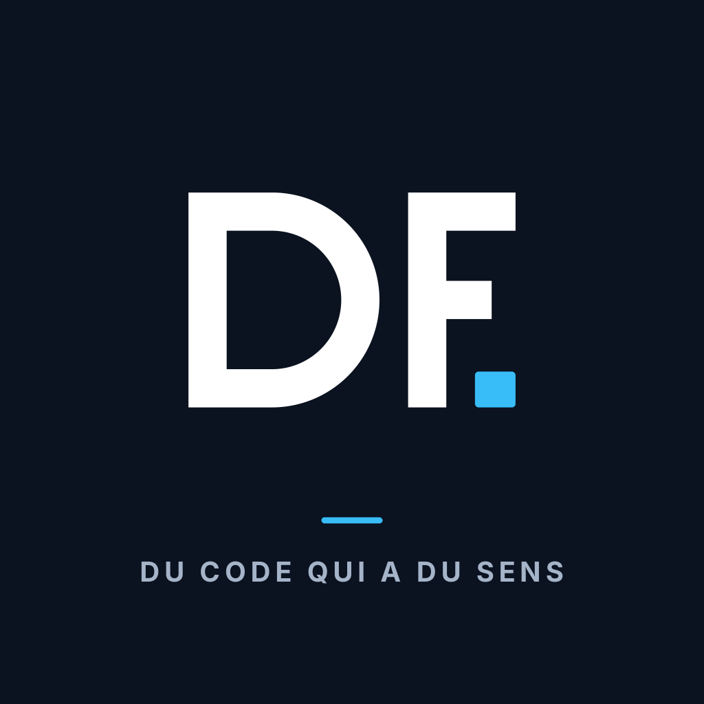

  

<h1 align="center">Nyankoye Daniel FELEMOU</h1>

<b>Développeur Fullstack Web &amp; Mobile</b> · <i>Du code qui a du sens</i>

  

---

## 👋 Salut, moi c'est Daniel

Développeur **Fullstack Web & Mobile**, actuellement focalisé sur le **frontend avec Next.js**.
J'aime construire des interfaces modernes, claires et utiles, du design jusqu'à la mise en production.

- 💼 **Aujourd'hui** : développeur frontend (Next.js / React)
- 🧱 **Avant** : développeur fullstack web (Angular, Laravel, React)
- 📱 **En ce moment** : je me tourne vers le développement mobile
- 💡 **Ma devise** : *du code qui a du sens*

## 🛠️ Stack

  
  
  
  
  
  
  
  
  

## 🚀 Projets

> Mes projets épinglés sont juste en dessous 👇

## 📫 Me contacter

<!-- Remplace les liens ci-dessous par les tiens, ou supprime ceux que tu n'utilises pas -->

  
  

